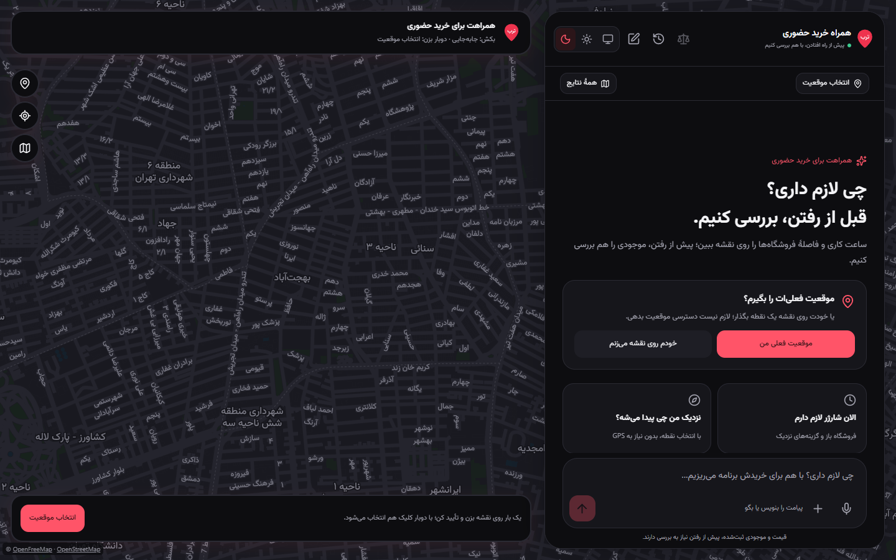
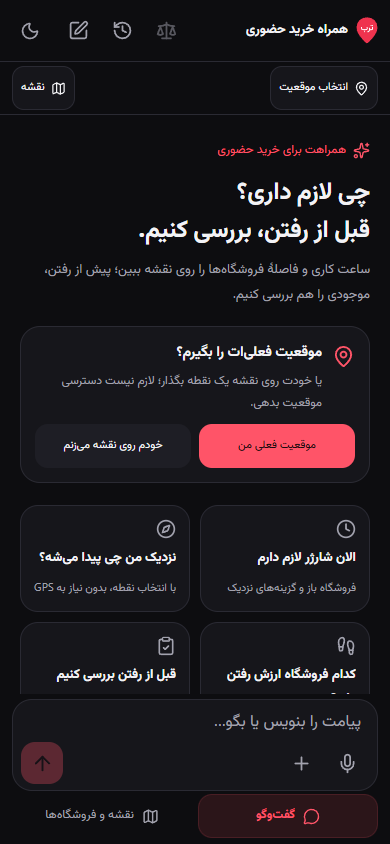
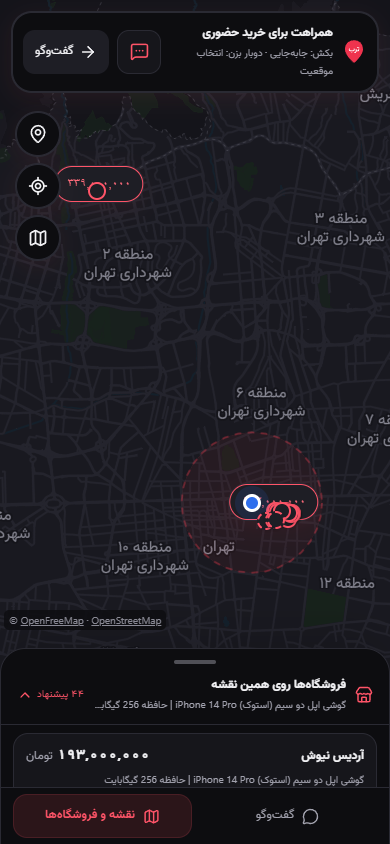

<div dir="rtl">

<p align="center">
  
</p>
<h1 align="center">همراه خرید حضوری</h1>
<p align="center">قبل از رفتن، انتخاب بهتری داشته باش؛ دستیار خرید فارسی با نقشهٔ تعاملی.</p>
<p align="center">فارسی · <a href="README.md">English</a></p>



از گفتن نیاز خرید تا مقایسهٔ فروشگاه‌های نزدیک و برنامه‌ریزی مراجعه، در یک مسیر پیوسته. گفت‌وگو و نقشه، انتخاب‌ها، موقعیت و شرایط خرید را با هم حفظ می‌کنند.

## قابلیت‌ها

- **گفت‌وگوی پیوسته:** حفظ نیاز کالا و بودجه پس از پیام‌های بعدی و تعیین موقعیت.
- **تایپ کمتر، رابط خلوت‌تر:** پاسخ‌های آمادهٔ کوچک متناسب با مرحلهٔ خرید؛ ورود فقط اطلاعات مرتبط در پنجره‌ای با پس‌زمینهٔ تار، بدون خارج‌شدن از چت و نقشه.
- **هماهنگی چت و نقشه:** دستیار شناور روی دسکتاپ و نمایش تمام‌صفحه در گوشی، با حفظ مسیر کاربر هنگام جابه‌جایی میان چت و نقشه.
- **برنامه‌ریزی مراجعه:** ساعت کاری ثبت‌شده، فاصله، مسیر پیاده، خودرو و دوچرخه، تخمین رسیدن و اتصال به نشان، بلد و Google Maps.
- **مقایسهٔ کاربردی:** مشخصات کالا، قیمت و اطلاعات فروشگاه در پنل مستقل، با نمایش تفاوت‌ها و امکان پاک‌کردن انتخاب‌ها.
- **مسیر خرید کامل:** پیش‌نویس پیگیری، شبیه‌سازی شفاف پاسخ فروشنده، چک‌لیست مراجعه، ذخیرهٔ برنامه و پایان خرید.
- **صوت و رابط دسترس‌پذیر:** تبدیل گفتار به متن قابل ویرایش، خواندن متن، طراحی راست‌به‌چپ، تم روشن و تیره و کنترل‌های مناسب لمس.

<p align="center">
  
  
</p>

تصاویر، نمونهٔ اجرای محلی برنامه‌اند. اطلاعات کاتالوگ، سابقهٔ ثبت‌شده است و قیمت یا موجودی زنده را تأیید نمی‌کند. کاتالوگ موجود مربوط به تهران است؛ نقشهٔ پایه امکان مشاهدهٔ مناطق دیگر را هم دارد.

## اجرای محلی

**پیش‌نیازها:** Git، پایتون ۳٫۱۲ یا ۳٫۱۴ با SQLite FTS5، نسخهٔ ۲۴ Node.js و یک کاتالوگ CSV سازگار. کلیدها در بک‌اند نگه‌داری می‌شوند. سرویس‌های هوش مصنوعی، صوت، کاشی نقشه و مسیر خیابانی به اینترنت نیاز دارند.

### ۱. کلون و نصب — در CMD ویندوز

```cmd
git clone https://github.com/tig-ndi/torob-inperson-assistant.git
cd torob-inperson-assistant
python -m venv .venv
.venv\Scripts\python.exe -m pip install -r requirements.lock.txt
npm --prefix apps/web ci
copy .env.example .env
```

### ۲. آماده‌سازی کاتالوگ؛ فقط بار اول

دیتاست اصلی و دیتابیس‌های ساخته‌شده **داخل Git منتشر نمی‌شوند**. سه فایل سازگار `shops.csv`، `products.csv` و `offers.csv` را در یک پوشه قرار بدهید و اجرا کنید:

```cmd
.venv\Scripts\python.exe -X utf8 -m tools.prepare_data --source "C:\path\to\catalogue-csv"
```

مسیر نمونه را با مسیر پوشهٔ خودتان عوض کنید. این دستور `.local/catalogue.sqlite3` و گزارش اعتبارسنجی را می‌سازد و خروجی قبلی را بازنویسی نمی‌کند. جزئیات در [راهنمای قالب داده و ورود کاتالوگ](docs/DATA.md) آمده است.

### ۳. واردکردن کلیدها

فایل `.env` را باز کنید، دو کلید را قرار دهید و در صورت استفاده از صوت، آن را فعال کنید:

```dotenv
BOXAPI_API_KEY="your-boxapi-key"
AVALAI_API_KEY="your-avalai-key"
TOROB_VOICE_ENABLED=1
```

بقیهٔ تنظیمات در `.env.example` آماده‌اند. مدل پیش‌فرض دستیار `gpt-5.6-luna` است و حساب شما باید به مدل انتخاب‌شده دسترسی داشته باشد. نمونهٔ تنظیمات، سقف **۳ تلاش در مجموع** دارد؛ تلاش ناموفق هم محاسبه می‌شود. در صورت نیاز، `TOROB_ASSISTANT_ATTEMPT_LIMIT` را آگاهانه تغییر دهید؛ دفتر مصرف محلی با راه‌اندازی مجدد پاک نمی‌شود. اعتبار و محدودیت نرخ صوت، جداگانه توسط AvalAI مدیریت می‌شود.

### ۴. اجرای برنامه

```cmd
powershell -NoProfile -ExecutionPolicy Bypass -File .\run-local.ps1
```

نشانی **http://127.0.0.1:18120** را باز کنید. اجراکننده فرانت را build می‌کند، در صورت نبودن دفتر مصرف محلی آن را می‌سازد و API و رابط را با هم بالا می‌آورد. توقف با `Ctrl+C` است. دفعات بعد همین دستور کافی است؛ پس از ویرایش `.env`، برنامه را دوباره اجرا کنید. گزینهٔ `-SkipBuild` از build قبلی استفاده می‌کند و `-Offline` سرویس‌های ایجنت و صوت را خاموش می‌کند.

<details>
<summary>اجرا روی Linux و macOS</summary>

پس از کلون، از محیط مجازی مناسب سیستم استفاده کنید؛ مراحل کاتالوگ و تنظیمات همان هستند:

```sh
python3 -m venv .venv
.venv/bin/python -m pip install -r requirements.lock.txt
npm --prefix apps/web ci
cp .env.example .env
.venv/bin/python -X utf8 -m tools.prepare_data --source /path/to/catalogue-csv
# Edit .env with your own keys before starting.
npm --prefix apps/web run build
.venv/bin/python -c "from pathlib import Path; from apps.api.agent_usage import UsageLedger; UsageLedger(Path('.local/agent-usage.sqlite3')).connect().close()"
.venv/bin/python -m uvicorn apps.api.main:app --host 127.0.0.1 --port 18120 --no-access-log
```

</details>

## فناوری‌ها

**React · TypeScript · Vite · Tailwind CSS · MapLibre GL · FastAPI · SQLite FTS5**

رابط در `apps/web`، منطق خرید و اتصال سرویس‌ها در `apps/api` و ابزار ورود CSV در `tools/prepare_data.py` قرار دارد. قیمت، فاصله و وضعیت ساعت کاری با کد محاسبه می‌شوند؛ مدل زبانی نیاز مکالمه را تفسیر می‌کند. مستندات تعاملی API پس از اجرا در http://127.0.0.1:18120/docs در دسترس است.

## بررسی‌ها

```cmd
.venv\Scripts\python.exe -X utf8 -m unittest discover -s tests -v
npm --prefix apps/web run build
```

تست‌های بک‌اند از پاسخ‌های مصنوعی سرویس‌ها استفاده می‌کنند؛ تست‌های وابسته به کاتالوگ واقعی، در نبود آن اجرا نمی‌شوند. برای تست مرورگر موبایل و دسکتاپ، برنامه را با `-Offline` اجرا کنید؛ در پوشهٔ `apps/web` مرورگر را با `npx playwright install chromium` نصب و سپس `npm run test:local` را اجرا کنید. این بررسی‌ها، دسترسی زندهٔ سرویس‌های بیرونی را اثبات نمی‌کنند.

## داده و منابع

ساعت کاری ممکن است ثبت نشده یا قدیمی باشد. تخمین مسیر شامل ترافیک زنده نیست. تماس، استعلام موجودی و رزرو فروشنده صریحاً شبیه‌سازی هستند؛ تماس یا پیام واقعی ارسال نمی‌شود. فایل `.env`، CSVهای منبع، دیتابیس و دفتر مصرف را وارد Git نکنید.

نقشه از OpenFreeMap و OpenStreetMap و مسیر خیابانی از FOSSGIS / OSRM استفاده می‌کند. مجوز بخش‌های شخص ثالث در [LICENSES/torobche-MIT.txt](LICENSES/torobche-MIT.txt) حفظ شده است.

</div>
