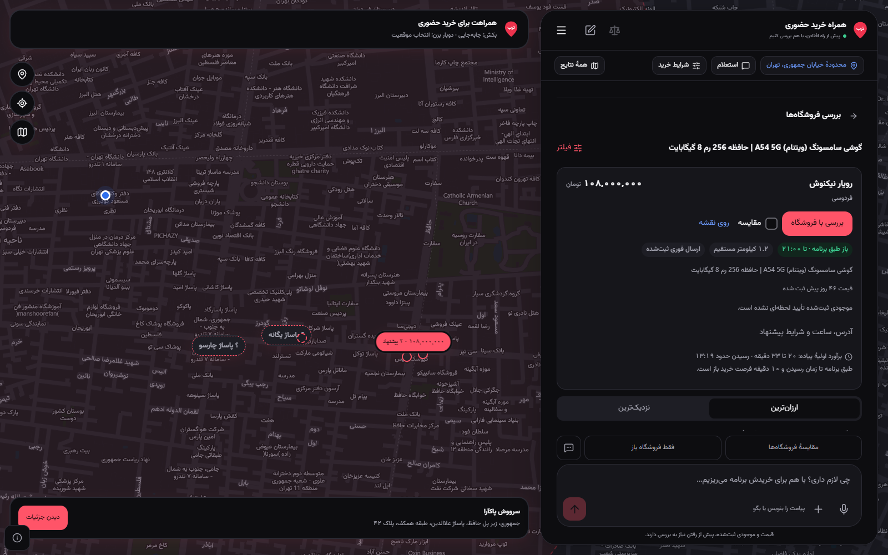
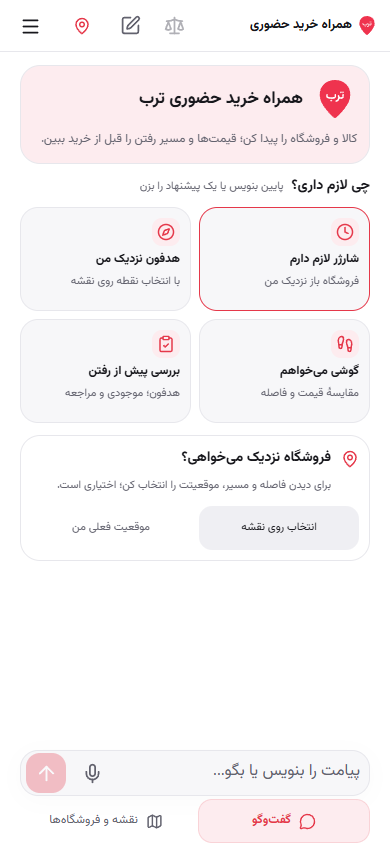
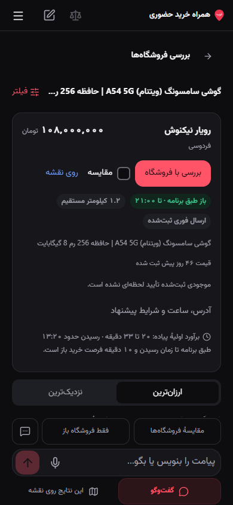
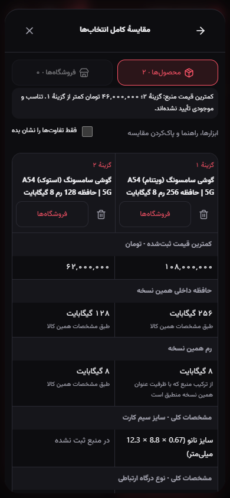
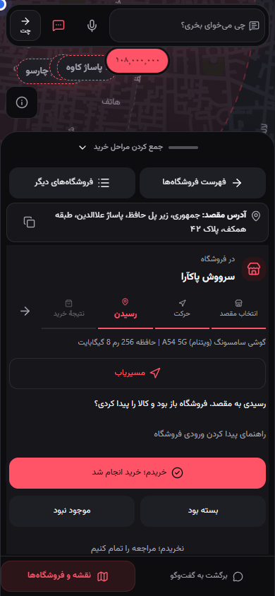
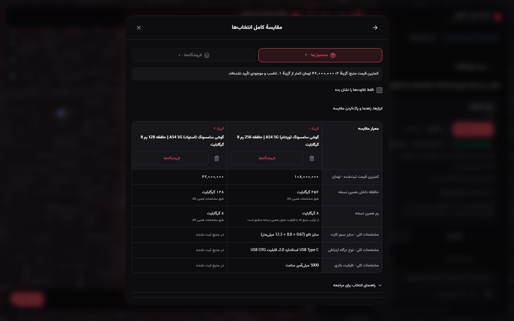

<div dir="rtl">

<p align="center">
  
</p>
<h1 align="center">همراه خرید حضوری ترب</h1>
<p align="center">نیازت را بگو؛ گزینه‌ها را مقایسه کن؛ با آگاهی راه بیفت.</p>
<p align="center">فارسی · <a href="README.md">English</a></p>

دستیار خرید فارسی ساخته‌شده برای **چالش استارکوچ**؛ ترکیبی از گفت‌وگو، اطلاعات ثبت‌شدهٔ کالا و نقشهٔ فروشگاه‌ها در یک محیط. نیاز و بودجه‌ات را بیان کن، انتخاب‌ها را دقیق‌تر کن و بدون ازدست‌دادن مسیر گفت‌وگو، برای خرید حضوری برنامه بریز.



## از بیان نیاز تا مراجعه به فروشگاه

- **گفت‌وگو و اصلاح نیاز:** شروع با پیام فارسی یا پیشنهادهای آماده؛ حفظ کالا، بودجه و شرایط پشتیبانی‌شده در ادامهٔ گفت‌وگو.
- **مقایسه پیش از تصمیم:** بررسی مشخصات ثبت‌شده، نسخه‌های مختلف کالا، قیمت فروشگاه‌ها، توضیح گارانتی و شرایط پرداخت حضوری.
- **انتخاب مقصد:** انتخاب نقطه روی نقشه یا موقعیت فعلی؛ بررسی فاصله، ساعت کاری ثبت‌شده و تخمین زمان رفتن، همراه با دسترسی به مسیریاب.
- **ادامهٔ خرید روی گوشی:** جابه‌جایی بین چت و نقشه، بازکردن کرکرهٔ مراحل خرید، برگشت به مرحلهٔ قبل، اعلام رسیدن و ثبت نتیجه.
- **شفافیت اطلاعات:** برچسب جدا برای قیمت ثبت‌شده، موجودی نامشخص، گزارش خود کاربر و پاسخ آزمایشی فروشنده.

## نگاهی نزدیک‌تر به تجربهٔ موبایل

**شروع و بررسی فروشگاه‌ها.** چهار پیشنهاد شروع، کاربرد محصول را روشن می‌کنند؛ کارت فروشگاه، قیمت، شرایط مراجعه و اقدام بعدی را کنار هم می‌آورد.

<p align="center">
  
  
</p>

**مقایسه و ادامهٔ مراجعه.** تفاوت مشخصات ثبت‌شدهٔ کالاها را ببین و همان مراحل خرید را داخل کرکرهٔ نقشه ادامه بده.

<p align="center">
  
  
</p>

<details>
<summary>مقایسه در دسکتاپ با حالت تیره</summary>



</details>

تصاویر در **۱۵ نوامبر ۲۰۲۶** از اجرای محلی نسخهٔ فعلی گرفته شده‌اند: دسکتاپ با اندازهٔ <span dir="ltr">۱۶۰۰ × ۱۰۰۰</span> و موبایل با اندازهٔ <span dir="ltr">۳۹۰ × ۸۴۴</span>. داده‌ها از کاتالوگ واقعی استارکوچ و مراحل از وضعیت‌های نمایشیِ بازیابی‌شده‌اند؛ درخواست مدل زنده یا ارتباط با فروشنده انجام نشده است. رابط برنامه در هر دو نسخهٔ README فارسی و راست‌به‌چپ است.

## اجرای محلی

می‌توانی جست‌وجوی کاتالوگ و رابط را **بدون کلید API** امتحان کنی و بعد، مدل زبانی را برای فهم گفت‌وگو فعال کنی.

**پیش‌نیازها:** Git، نسخهٔ ۲۴ Node.js همراه npm، و پایتون ۳٫۱۲ یا ۳٫۱۴ با SQLite FTS5. این دو نسخهٔ پایتون در CI بررسی می‌شوند. دریافت نقشه، مسیر خیابانی و سرویس‌های فعال هوش مصنوعی و صوت به اینترنت نیاز دارد.

### ۱. نصب پروژه — در CMD ویندوز

دستورها را در **Command Prompt** و از پوشه‌ای اجرا کن که می‌خواهی پروژه آنجا کلون شود:

<div dir="ltr">

```cmd
git clone https://github.com/tig-ndi/torob-inperson-assistant.git
cd torob-inperson-assistant
python -m venv .venv
.venv\Scripts\python.exe -m pip install -r requirements.lock.txt
npm --prefix apps/web ci
copy .env.example .env
```

</div>

محیط `.venv` را با نسخهٔ پشتیبانی‌شدهٔ پایتون بساز. اگر پروژه را از قبل داری، فایل `.env` تنظیم‌شدهٔ خودت را نگه دار و روی آن کپی نکن.

### ۲. دریافت و آماده‌سازی دیتاست مسابقه

دیتاست این پروژه **Starcoach v16، نسخهٔ cap300 CSV** است که برای چالش ارائه شده است. [دانلود دیتاست چالش استارکوچ](https://startech.s3.ir-central1.arvanstorage.ir/starcoach-dataset-v16-cap300-csv.zip?versionId=) را بزن، ZIP را استخراج کن و پوشه‌ای را پیدا کن که هر سه فایل زیر داخلش باشند:

<div dir="ltr">

```text
starcoach-dataset-v16-cap300-csv/
  shops.csv
  products.csv
  offers.csv
```

</div>

از ریشهٔ مخزن اجرا کن:

<div dir="ltr">

```cmd
.venv\Scripts\python.exe -X utf8 -m tools.prepare_data --source "%USERPROFILE%\Downloads\starcoach-dataset-v16-cap300-csv"
```

</div>

اگر جای دیگری استخراج کرده‌ای یا ZIP پوشهٔ تودرتو ساخته، مسیر نمونه را عوض کن. ابزار ورود، CSVها را اعتبارسنجی می‌کند، نمایهٔ جست‌وجوی SQLite را می‌سازد و فایل‌های `.local/catalogue.sqlite3` و `.local/data-profile.json` را می‌نویسد. CSVهای اصلی تغییر نمی‌کنند و خروجی موجود بازنویسی نمی‌شود. برای ورود دوباره، مطابق [راهنمای داده](docs/DATA.md) مسیرهای خروجی جدید انتخاب کن.

این داده‌ها **تصویر ثبت‌شده‌ای از فروشگاه‌های تهران** هستند؛ قیمت یا موجودی زنده نیستند. لینک دانلود در اختیار توست؛ CSVهای منبع و دیتابیس‌های ساخته‌شده داخل Git توزیع نمی‌شوند.

### ۳. امتحان برنامه بدون کلید API

<div dir="ltr">

```cmd
powershell -NoProfile -ExecutionPolicy Bypass -File .\run-local.ps1 -Offline
```

</div>

نشانی **http://127.0.0.1:18120** را باز کن. نام سادهٔ کالا مثل «هدفون» یا «گوشی تا ده میلیون می‌خواهم» را بنویس، فروشگاه‌های محصول را باز کن و مقایسه و نقشه را ببین. حالت Offline مدل و صوت را خاموش می‌کند؛ جست‌وجوی سادهٔ کاتالوگ فعال است، نه فهم کامل گفت‌وگو. دریافت نقشه و مسیر همچنان اینترنت می‌خواهد.

اجراکننده فرانت را build می‌کند، کاتالوگ را باز می‌کند، دفتر مصرف **محلی** را در صورت نبودن می‌سازد و رابط و API را با هم بالا می‌آورد. توقف با `Ctrl+C` است. در اجراهای بعد، `-SkipBuild` از build قبلی استفاده می‌کند.

### ۴. فعال‌کردن دستیار گفت‌وگو

به دسترسی API، کلید معتبر و مدلی نیاز داری که حساب تو اجازهٔ استفاده از آن را داشته باشد. این دسترسی می‌تواند از اعتبار رایگان یا موجودی خریداری‌شده باشد؛ اشتراک یک سایت چت لزوماً شامل API نیست. در این راهنما خرید سرویس یا پلن مشخصی پیشنهاد نمی‌شود.

**سازگاری نسخهٔ فعلی:** آداپتور متنی به درگاه ثابت `https://ai.boxapi.ir/ai/v1/chat/completions` وصل می‌شود و کلید را از تنظیم `BOXAPI_API_KEY` می‌خواند. می‌توانی مدل پشتیبانی‌شدهٔ دیگری از همین درگاه انتخاب کنی. کلید سرویس دیگری فقط با تغییر `.env` کار نمی‌کند: آدرس پایهٔ سرویس متنی در این نسخه قابل تنظیم نیست و اتصال به endpoint دیگر نیازمند تغییر آداپتور است.

فایل `.env` در ریشهٔ مخزن را ویرایش کن:

<div dir="ltr">

```dotenv
BOXAPI_API_KEY=YOUR_API_KEY
TOROB_ASSISTANT_ENABLED=1
TOROB_ASSISTANT_MODEL=gpt-5.6-luna
TOROB_ASSISTANT_ATTEMPT_LIMIT=3
TOROB_VOICE_ENABLED=0
```

</div>

به‌جای `YOUR_API_KEY` کلید خودت را بگذار و مدلی را انتخاب کن که در حسابت فعال است. مدل نمونه، پیش‌فرض مخزن است؛ دسترسی حساب به آن باید جدا بررسی شود.

<details>
<summary>شناسهٔ مدل‌های پذیرفته‌شده در این نسخه</summary>

یکی از شناسه‌های دقیق فهرست فعلی را وارد کن:

<div dir="ltr">

```text
gpt-6.1-sol
gpt-6-luna
gpt-5.6-luna
gpt-5-mini
gpt-5.4-mini
deepseek/deepseek-v4.1-flash-1017
```

</div>

سرویس نیز باید همین شناسه را برای حساب تو ارائه کند. نام دلخواه مدل به خطای `invalid_config` می‌رسد؛ عوض‌کردن نام، سازگاری با سرویس جدید ایجاد نمی‌کند. پیاده‌سازی در [آداپتور دستیار](apps/api/assistant.py) است.

</details>

سقف تلاش، **محدودیت کل و ماندگار برنامه** است و تلاش ناموفق هم حساب می‌شود. مقدار نمونه ۳ است؛ برای تست بیشتر، آگاهانه افزایشش بده. راه‌اندازی مجدد دفتر مصرف را صفر نمی‌کند. این سقف از اعتبار و محدودیت نرخ سرویس جداست؛ برای صفرکردن آن دفتر مصرف را پاک نکن.

برنامه را این بار **بدون** `-Offline` دوباره اجرا کن:

<div dir="ltr">

```cmd
powershell -NoProfile -ExecutionPolicy Bypass -File .\run-local.ps1
```

</div>

نیازت را فارسی بگو، بودجه اضافه کن، شرایط را اصلاح کن، کالاها را مقایسه کن و نقطهٔ جست‌وجو را انتخاب کن. ارسال پیام می‌تواند از اعتبار سرویس مصرف کند.

<details>
<summary>ورودی صوتی و خواندن پاسخ؛ اختیاری</summary>

چت متنی به کلید صوت نیاز ندارد. اتصال صوتی فعلی جداگانه از AvalAI استفاده می‌کند. `AVALAI_API_KEY=YOUR_AUDIO_API_KEY` را اضافه کن و `TOROB_VOICE_ENABLED=1` بگذار، سپس برنامه را دوباره اجرا کن. اعتبار، دسترسی مدل و محدودیت نرخ صوت مستقل‌اند؛ سقف تلاش دستیار متنی آن‌ها را کنترل نمی‌کند.

</details>

<details>
<summary>راه‌اندازی روی Linux و macOS</summary>

ابتدا مخزن را کلون و همان دیتاست را استخراج کن. از ریشهٔ مخزن:

<div dir="ltr">

```sh
python3 -m venv .venv
.venv/bin/python -m pip install -r requirements.lock.txt
npm --prefix apps/web ci
cp .env.example .env
.venv/bin/python -X utf8 -m tools.prepare_data --source /absolute/path/to/starcoach-csv
npm --prefix apps/web run build
.venv/bin/python -c "from pathlib import Path; from apps.api.agent_usage import UsageLedger; UsageLedger(Path('.local/agent-usage.sqlite3')).connect().close()"
```

</div>

فایل `.env` را مطابق توضیحات بالا تنظیم کن و اجرا کن:

<div dir="ltr">

```sh
.venv/bin/python -m uvicorn apps.api.main:app --host 127.0.0.1 --port 18120 --no-access-log
```

</div>

برای خاموش‌بودن سرویس‌های خارجی مدل و صوت، به‌جای دستور بالا اجرا کن:

<div dir="ltr">

```sh
TOROB_ASSISTANT_ENABLED=0 TOROB_VOICE_ENABLED=0 .venv/bin/python -m uvicorn apps.api.main:app --host 127.0.0.1 --port 18120 --no-access-log
```

</div>

از `python3` مربوط به نسخهٔ پشتیبانی‌شده استفاده کن، مسیر CSVها را عوض کن و کپی `.env.example` را فقط در راه‌اندازی اولیه انجام بده. ساخت اولیهٔ دفتر مصرف، تلاش‌های موجود را حفظ می‌کند.

</details>

## بررسی راه‌اندازی و رفع اشکال

- **http://127.0.0.1:18120/api/health/ready** باید برای `catalogue`، `usage` و `web` مقدار `ready` نشان بدهد.
- **http://127.0.0.1:18120/api/assistant/status** تنظیمات و تعداد تلاش باقی‌ماندهٔ محلی را نشان می‌دهد؛ پیام به مدل نمی‌فرستد و اعتبار سرویس را تأیید نمی‌کند.
- مستندات تعاملی API در **http://127.0.0.1:18120/docs** هستند.

راه‌حل خطاهای متداول:

- **نبودن کاتالوگ:** پیش از اجرا، پوشهٔ شامل هر سه CSV را وارد کن.
- **`invalid_config`:** مدل پذیرفته‌شده و سقف تلاشِ عدد صحیح مثبت انتخاب کن.
- **`missing_key` یا `provider_auth`:** کلید، درگاه و دسترسی مدل را بررسی و برنامه را دوباره اجرا کن.
- **`attempt_limit`:** سقف محلی را آگاهانه افزایش بده و دفتر مصرف موجود را حفظ کن.
- **`provider_budget` یا محدودیت نرخ:** حساب سرویس را بررسی کن؛ افزایش سقف محلی، اعتبار API اضافه نمی‌کند.
- **دریافت‌نشدن نقشه:** اتصال به سرویس نقشه را بررسی کن؛ نتایج کاتالوگ همچنان قابل استفاده‌اند.

## توسعه و بررسی‌ها

**React · TypeScript · Vite · Tailwind CSS · MapLibre GL · FastAPI · SQLite FTS5**

مدل، نیاز خرید را تفسیر می‌کند؛ کد برنامه آن را با شواهد کاتالوگ اعتبارسنجی می‌کند و نمایش قیمت ثبت‌شده، محاسبهٔ فاصله و ارزیابی ساعت کاری را انجام می‌دهد. بخش‌های اصلی: [رابط وب](apps/web)، [API](apps/api)، [ورود CSV](tools/prepare_data.py) و [تست‌های بک‌اند](tests).

<div dir="ltr">

```cmd
.venv\Scripts\python.exe -X utf8 -m unittest discover -s tests -v
npm --prefix apps/web run test:unit
npm --prefix apps/web run build
```

</div>

برای تست مرورگری مستقل در ویندوز، از ریشهٔ مخزن اجرا کن:

<div dir="ltr">

```cmd
npx --prefix apps/web playwright install chromium
set "TOROB_TEST_PYTHON=%CD%\.venv\Scripts\python.exe"
npm --prefix apps/web run test:ci
```

</div>

روی Linux و macOS، بعد از نصب Chromium از `TOROB_TEST_PYTHON="$PWD/.venv/bin/python" npm --prefix apps/web run test:ci` استفاده کن. CI سرور کاتالوگ مصنوعی را بالا می‌آورد و با پاسخ‌های کنترل‌شده، بدون درخواست مدل زنده بررسی می‌کند. تست‌های بک‌اندِ وابسته به snapshot واقعی، در نبود آن اجرا نمی‌شوند.

<details>
<summary>Docker و نگه‌داری پایدار داده‌ها</summary>

[Dockerfile](Dockerfile) رابط را build می‌کند و `python -m tools.serve` را روی پورت `8000` اجرا می‌کند. داده‌ها جداگانه روی دیسک پایدار متصل به `/data` قرار می‌گیرند:

<div dir="ltr">

```dotenv
TOROB_DATABASE=/data/catalogue.sqlite3
TOROB_USAGE_DATABASE=/data/agent-usage.sqlite3
```

</div>

با [ابزار خروجی انتقال](tools/export_deploy_data.py)، از هر دو دیتابیس موجود نسخهٔ سازگار در پوشه‌ای خصوصی و جدید، بیرون از بستهٔ کد بگیر. دفتر مصرف را حفظ کن. پوشهٔ متصل‌شده و دفتر مصرف باید برای UID/GID کانتینر، یعنی **10001**، قابل نوشتن باشند؛ فایل‌های آپلودشده با FTP و مالک دیگر ممکن است به اصلاح مالکیت نیاز داشته باشند. اجرای production در نبود کاتالوگ، دفتر مصرف قابل نوشتن یا فرانت متوقف می‌شود؛ این بررسی جدا از اعتبار API است.

</details>

## مرز داده‌ها و منابع

قیمت‌ها به **تومان** و ثبت‌شده‌اند. موجودی تأییدنشده است؛ گزارش خود کاربر و پاسخ آزمایشی فروشنده جدا برچسب می‌خورند و هیچ‌کدام جریان زندهٔ موجودی نیستند. ساعت کاری ممکن است نامشخص یا قدیمی باشد و تخمین مسیر شامل ترافیک زنده نیست. پاسخ و رزرو آزمایشی، پیام نمی‌فرستند، سفارش ثبت نمی‌کنند و موجودی واقعی رزرو نمی‌کنند. در صورت وجود لینک تماس، بازکردن کانال واقعی انتخاب خود کاربر است.

دیتاست چالش استارکوچ در بالا معرفی و لینک شده و در این مخزن بازتوزیع نمی‌شود. کلیدها، `.env`، CSVهای اصلی، دیتابیس‌ها و دفتر مصرف را وارد Git نکن. سوابق مصرف به‌صورت محلی ماندگارند و زمینهٔ خرید در نشست مرورگر نگه‌داری می‌شود.

نقشه از [OpenFreeMap](https://openfreemap.org/) و [OpenStreetMap](https://www.openstreetmap.org/copyright) و مسیر خیابانی از [FOSSGIS / OSRM](https://routing.openstreetmap.de/about.html) استفاده می‌کند. مجوزهای ثالث در [LICENSES/torobche-MIT.txt](LICENSES/torobche-MIT.txt) حفظ شده‌اند. قرارداد داده و جزئیات ورود در [docs/DATA.md](docs/DATA.md) آمده است.

</div>
