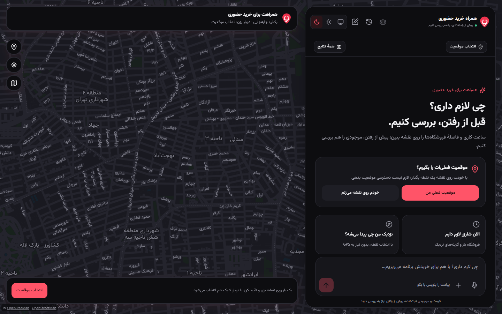
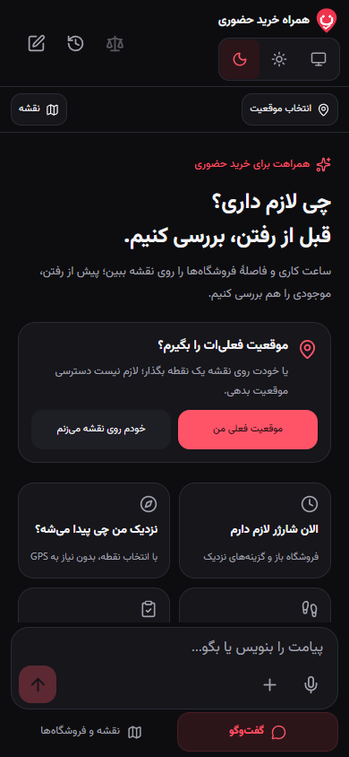
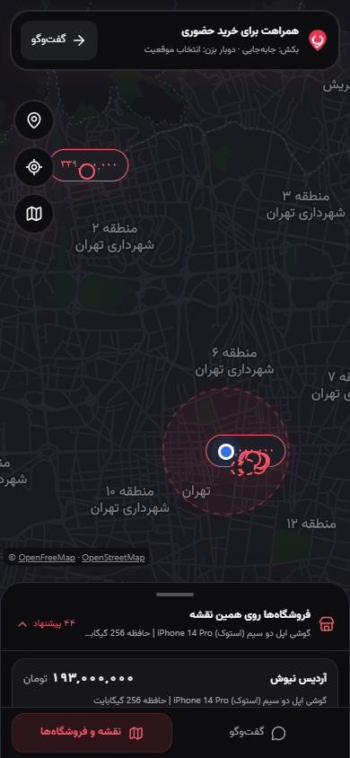

<p align="center">
  
</p>
<h1 align="center">In-Person Shopping Companion</h1>
<p align="center">Find the right shop before you leave — a Persian shopping assistant with an interactive map.</p>
<p align="center"><a href="README.fa.md">فارسی</a> · English</p>



A continuous journey from describing what you need to comparing nearby shops and planning a visit. Chat and map share the same selections, location and shopping context.

## What it does

- **Context-aware conversation:** keeps product requirements and budget across follow-up messages and location selection, with compact suggested replies.
- **Connected chat and map:** a floating desktop assistant; full-screen mobile views that preserve your place when switching between conversation and map.
- **Practical visit planning:** recorded opening hours, distance, walking/driving/cycling routes, arrival estimates, and links to Neshan, Balad and Google Maps.
- **Useful comparisons:** product specifications, prices and shop details in a dedicated comparison dialog, with differences and reset controls.
- **A complete local journey:** follow-up drafts, clearly labeled seller simulations, visit checklists, saved plans and purchase completion.
- **Voice and accessible controls:** editable speech transcription, text-to-speech, Persian RTL layout, light/dark themes and touch-friendly actions.

<p align="center">
  
  
</p>

Screenshots show local example journeys. Catalogue records are historical evidence, not confirmed live prices or stock. The supplied catalogue covers Tehran; the base map can be explored elsewhere.

## Run locally

**Requirements:** Git, Python 3.12 or 3.14 with SQLite FTS5, Node.js 24, and a compatible CSV catalogue. API keys are kept on the backend. Internet access is needed for external AI, speech, map tiles and road routes.

### 1. Clone and install — Windows CMD

```cmd
git clone https://github.com/tig-ndi/torob-inperson-assistant.git
cd torob-inperson-assistant
python -m venv .venv
.venv\Scripts\python.exe -m pip install -r requirements.lock.txt
npm --prefix apps/web ci
copy .env.example .env
```

### 2. Prepare the catalogue once

The source dataset and generated databases are **not distributed in Git**. Place your compatible `shops.csv`, `products.csv` and `offers.csv` in one folder, then run:

```cmd
.venv\Scripts\python.exe -X utf8 -m tools.prepare_data --source "C:\path\to\catalogue-csv"
```

Replace the example path with your own. This creates `.local/catalogue.sqlite3` and its validation report. The importer preserves existing output files; see the [data format and import guide](docs/DATA.md).

### 3. Add your keys

Open `.env`, fill in the two keys, and enable voice if you want to use it:

```dotenv
BOXAPI_API_KEY="your-boxapi-key"
AVALAI_API_KEY="your-avalai-key"
TOROB_VOICE_ENABLED=1
```

Other settings are already in `.env.example`. The default assistant model is `gpt-5.6-luna`; your account must support the configured model. The example limits the assistant to **3 total attempts**, including failures. Adjust `TOROB_ASSISTANT_ATTEMPT_LIMIT` deliberately when needed; its local usage ledger survives restarts. Speech credit and rate limits are managed separately by AvalAI.

### 4. Start the app

```cmd
powershell -NoProfile -ExecutionPolicy Bypass -File .\run-local.ps1
```

Open **http://127.0.0.1:18120**. The launcher builds the frontend, initializes a missing local usage ledger and starts the API and UI together. Stop with `Ctrl+C`. On later runs, use the same command; restart after editing `.env`. `-SkipBuild` reuses a previous frontend build, and `-Offline` disables the AI and speech providers.

<details>
<summary>Linux / macOS</summary>

After cloning, use the platform-specific environment and the same catalogue/configuration steps:

```sh
python3 -m venv .venv
.venv/bin/python -m pip install -r requirements.lock.txt
npm --prefix apps/web ci
cp .env.example .env
.venv/bin/python -X utf8 -m tools.prepare_data --source /path/to/catalogue-csv
# Edit .env with your own keys before starting.
npm --prefix apps/web run build
.venv/bin/python -c "from pathlib import Path; from apps.api.agent_usage import UsageLedger; UsageLedger(Path('.local/agent-usage.sqlite3')).connect().close()"
.venv/bin/python -m uvicorn apps.api.main:app --host 127.0.0.1 --port 18120 --no-access-log
```

</details>

## Built with

**React · TypeScript · Vite · Tailwind CSS · MapLibre GL · FastAPI · SQLite FTS5**

`apps/web` contains the interface, `apps/api` the validated shopping and provider logic, and `tools/prepare_data.py` the CSV importer. Prices, distances and opening-hour decisions are calculated in code; the language model interprets the conversation. Local API documentation is available at http://127.0.0.1:18120/docs.

## Checks

```cmd
.venv\Scripts\python.exe -X utf8 -m unittest discover -s tests -v
npm --prefix apps/web run build
```

The backend suite uses mocked providers; snapshot-specific cases skip if the local catalogue is absent. For the current mobile/desktop browser suite, start the app with `-Offline`, install Chromium with `npx playwright install chromium` from `apps/web`, then run `npm run test:local` there. These checks do not establish live provider availability.

## Data and attribution

Recorded shop hours can be missing or out of date. Route times exclude live traffic. Seller contact, stock checks and reservations are explicitly simulated; the app does not place real calls or send seller messages. Never commit `.env`, source CSVs, local databases or usage ledgers.

Maps use OpenFreeMap / OpenStreetMap; road routing uses FOSSGIS / OSRM. Existing third-party attribution is preserved in [LICENSES/torobche-MIT.txt](LICENSES/torobche-MIT.txt).
