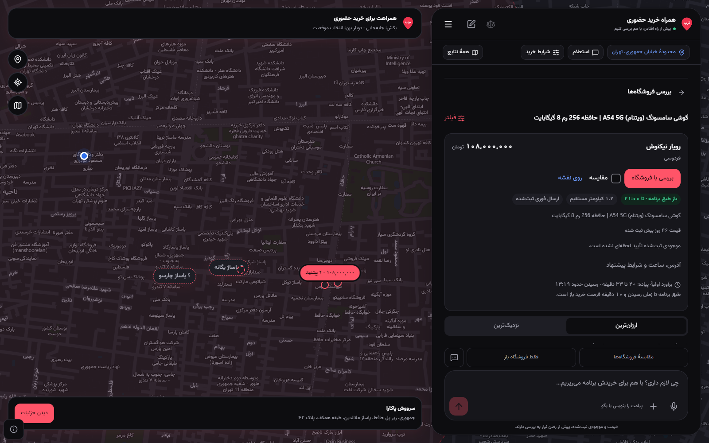
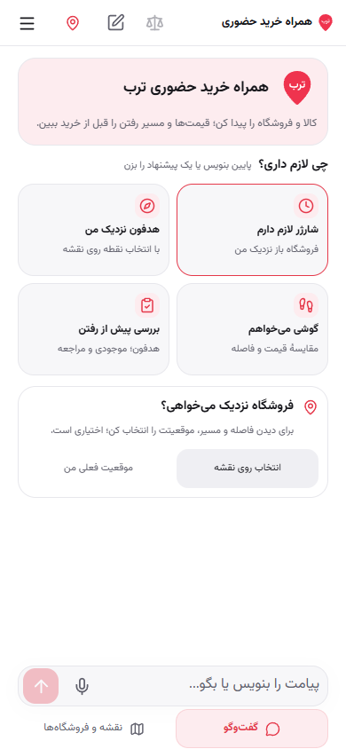
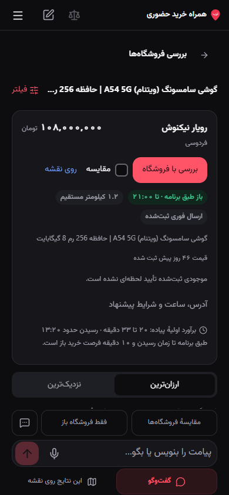
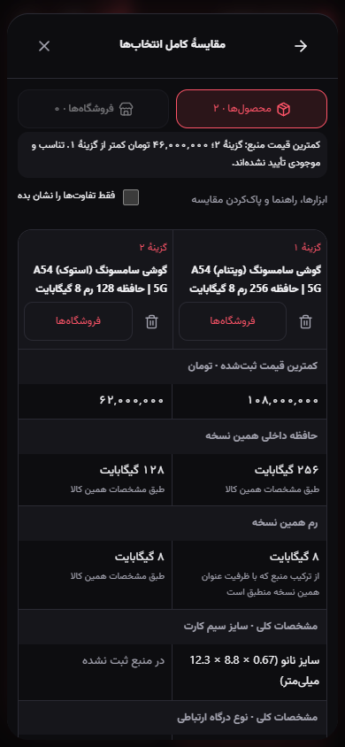
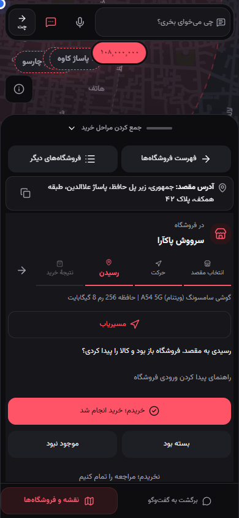
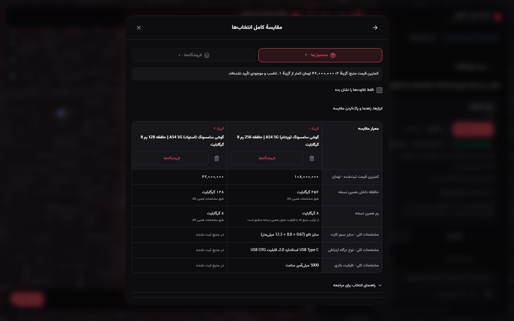

<p align="center">
  
</p>
<h1 align="center">In-Person Shopping Companion</h1>
<p align="center">Describe your purchase. Compare the options. Know where to go.</p>
<p align="center">English · <a href="README.fa.md">فارسی</a></p>

A Persian shopping assistant built for the **Starcoach challenge**, connecting conversation, recorded product information and a map of shops in one workspace. Start with a need and a budget, refine your choices, and plan an in-person visit without losing the conversation.



## From a shopping need to a store visit

- **Describe and refine:** use Persian conversation or suggested starts; retain the current product, budget and supported requirements across follow-ups.
- **Compare before deciding:** inspect recorded specifications, product variants, shop prices, warranty descriptions and in-person payment conditions.
- **Choose where to go:** select a map point or use your location; review distance, recorded hours and estimated travel, then open a navigation app.
- **Continue on your phone:** switch between chat and map, expand the purchase drawer, go back a stage, report arrival and record the outcome.
- **Keep uncertainty visible:** recorded prices, unknown inventory, your own reports and experimental seller responses have different labels.

## A closer look on mobile

**Start and explore shops.** Four suggested starts explain the product; shop cards bring the price, visit conditions and next action together.

<p align="center">
  
  
</p>

**Compare and continue the visit.** Compare recorded product differences, then use the same purchase stages inside the map drawer.

<p align="center">
  
  
</p>

<details>
<summary>Desktop comparison in dark mode</summary>



</details>

Screenshots were captured from the current local build on **15 November 2026**, at 1600 × 1000 on desktop and 390 × 844 on mobile. They use actual Starcoach catalogue records and restored demo states, with no live model calls or seller contact. The interface is Persian and right-to-left in both README versions.

## Run locally

You can try catalogue search and the interface **without an API key**, then enable the language model for conversational interpretation.

**Requirements:** Git, Node.js 24 with npm, and Python 3.12 or 3.14 with SQLite FTS5. These Python versions are exercised by CI. Map tiles, road routing and enabled AI/audio services require internet access.

### 1. Install — Windows CMD

Run these commands in **Command Prompt**, from the directory where you want to clone the project:

```cmd
git clone https://github.com/tig-ndi/torob-inperson-assistant.git
cd torob-inperson-assistant
python -m venv .venv
.venv\Scripts\python.exe -m pip install -r requirements.lock.txt
npm --prefix apps/web ci
copy .env.example .env
```

Create `.venv` using a supported Python installation. On an existing checkout, keep your configured `.env` instead of copying over it.

### 2. Download and import the challenge dataset

The project uses **Starcoach v16, cap300 CSV**, supplied for the challenge. [Download the Starcoach challenge dataset](https://startech.s3.ir-central1.arvanstorage.ir/starcoach-dataset-v16-cap300-csv.zip?versionId=), extract the ZIP, and locate the directory containing all three files:

```text
starcoach-dataset-v16-cap300-csv/
  shops.csv
  products.csv
  offers.csv
```

From the repository root, run:

```cmd
.venv\Scripts\python.exe -X utf8 -m tools.prepare_data --source "%USERPROFILE%\Downloads\starcoach-dataset-v16-cap300-csv"
```

Replace the path if you extracted elsewhere or the ZIP created an extra nested folder. The importer validates the CSVs, creates the SQLite search index, and writes `.local/catalogue.sqlite3` and `.local/data-profile.json`. Source CSVs are unchanged and existing outputs are never overwritten. For another import, choose new output paths as described in the [data guide](docs/DATA.md).

This is a **recorded snapshot of shops in Tehran**, not a live price or stock feed. The source dataset is linked for download; CSVs and generated databases are not distributed in Git.

### 3. Try the app without an API key

```cmd
powershell -NoProfile -ExecutionPolicy Bypass -File .\run-local.ps1 -Offline
```

Open **http://127.0.0.1:18120**. Try a simple product name such as `هدفون` or `گوشی تا ده میلیون می‌خواهم`, open a product's shops, then explore comparison and map views. Offline mode disables the model and audio; it supports simple catalogue search rather than full conversational interpretation. Map and route services still need internet.

The launcher builds the frontend, opens the catalogue, initializes a missing **local** usage ledger, and serves the UI and API together. Stop with `Ctrl+C`. On later runs, `-SkipBuild` reuses the previous frontend build.

### 4. Enable conversational shopping

Obtain API access with a key and a model available to your account. This may use free credit or a paid balance; a web chat subscription does not necessarily include API access. No purchase or pricing plan is recommended here.

**Current compatibility:** the text adapter uses a fixed gateway, `https://ai.boxapi.ir/ai/v1/chat/completions`, and the setting `BOXAPI_API_KEY`. You can choose a supported model offered by that gateway. A key from another provider will not work just by changing `.env`: this version has no configurable text-provider base URL, so another endpoint requires an adapter change.

Edit `.env` at the repository root:

```dotenv
BOXAPI_API_KEY=YOUR_API_KEY
TOROB_ASSISTANT_ENABLED=1
TOROB_ASSISTANT_MODEL=gpt-5.6-luna
TOROB_ASSISTANT_ATTEMPT_LIMIT=3
TOROB_VOICE_ENABLED=0
```

Replace `YOUR_API_KEY` and select a model available to your account. The example model matches the repository default; account access must be checked separately.

<details>
<summary>Model identifiers accepted by this version</summary>

Use an exact identifier from the current allowlist:

```text
gpt-6.1-sol
gpt-6-luna
gpt-5.6-luna
gpt-5-mini
gpt-5.4-mini
deepseek/deepseek-v4.1-flash-1017
```

The provider must also offer that identifier to your account. An arbitrary model name produces `invalid_config`; changing it does not add provider compatibility. See [the assistant adapter](apps/api/assistant.py).

</details>

The attempt limit is the application's **persistent total cap**, including failed attempts. The example allows 3; increase it deliberately for more testing. Restarting does not reset the ledger. This limit is separate from provider credit and rate limits; do not delete the ledger to reset it.

Restart **without** `-Offline`:

```cmd
powershell -NoProfile -ExecutionPolicy Bypass -File .\run-local.ps1
```

Describe a purchase in Persian, add a budget, refine requirements, compare products and select a search location. Sending messages can consume provider credit.

<details>
<summary>Optional voice input and spoken answers</summary>

Text chat does not need an audio key. The current audio integration uses AvalAI separately. Add `AVALAI_API_KEY=YOUR_AUDIO_API_KEY` and set `TOROB_VOICE_ENABLED=1` in `.env`, then restart. Audio has its own provider balance, model access and rate limits; the text attempt cap does not control it.

</details>

<details>
<summary>Linux / macOS setup</summary>

Clone the repository and extract the same dataset first. From the repository root:

```sh
python3 -m venv .venv
.venv/bin/python -m pip install -r requirements.lock.txt
npm --prefix apps/web ci
cp .env.example .env
.venv/bin/python -X utf8 -m tools.prepare_data --source /absolute/path/to/starcoach-csv
npm --prefix apps/web run build
.venv/bin/python -c "from pathlib import Path; from apps.api.agent_usage import UsageLedger; UsageLedger(Path('.local/agent-usage.sqlite3')).connect().close()"
```

Configure `.env` as above, then start:

```sh
.venv/bin/python -m uvicorn apps.api.main:app --host 127.0.0.1 --port 18120 --no-access-log
```

To disable external AI/audio services instead:

```sh
TOROB_ASSISTANT_ENABLED=0 TOROB_VOICE_ENABLED=0 .venv/bin/python -m uvicorn apps.api.main:app --host 127.0.0.1 --port 18120 --no-access-log
```

Use `python3` from a supported installation, replace the CSV path, and copy `.env.example` only on initial setup. Ledger initialization preserves existing attempts.

</details>

## Verify and troubleshoot

- **http://127.0.0.1:18120/api/health/ready** should report `ready` for `catalogue`, `usage` and `web`.
- **http://127.0.0.1:18120/api/assistant/status** shows configuration and the local remaining attempt count. It does not send a prompt or verify upstream credit.
- Interactive API documentation is at **http://127.0.0.1:18120/docs**.

Common fixes:

- **Catalogue missing:** import the directory containing all three CSVs before starting.
- **`invalid_config`:** use an accepted model and a positive integer attempt limit.
- **`missing_key` / `provider_auth`:** check the key, gateway and model permissions, then restart.
- **`attempt_limit`:** deliberately increase the local cap while preserving the existing ledger.
- **`provider_budget` / rate limits:** check the provider account; increasing the local cap does not add API credit.
- **Map unavailable:** check connectivity to the map service; catalogue results remain usable.

## Development and checks

**React · TypeScript · Vite · Tailwind CSS · MapLibre GL · FastAPI · SQLite FTS5**

The model interprets intent; application code validates it against catalogue evidence and handles recorded prices, distance calculations and opening-hour decisions. Main areas: [web UI](apps/web), [API](apps/api), [CSV importer](tools/prepare_data.py), and [backend tests](tests).

```cmd
.venv\Scripts\python.exe -X utf8 -m unittest discover -s tests -v
npm --prefix apps/web run test:unit
npm --prefix apps/web run build
```

For isolated browser checks on Windows, from the repository root:

```cmd
npx --prefix apps/web playwright install chromium
set "TOROB_TEST_PYTHON=%CD%\.venv\Scripts\python.exe"
npm --prefix apps/web run test:ci
```

On Linux/macOS, use `TOROB_TEST_PYTHON="$PWD/.venv/bin/python" npm --prefix apps/web run test:ci` after installing Chromium. CI starts a synthetic catalogue server and uses controlled responses, without live model calls. Backend cases requiring the real snapshot skip when it is absent.

<details>
<summary>Docker and persistent data</summary>

The [Dockerfile](Dockerfile) builds the UI and runs `python -m tools.serve` on port `8000`. Supply persistent data separately, mounted at `/data`:

```dotenv
TOROB_DATABASE=/data/catalogue.sqlite3
TOROB_USAGE_DATABASE=/data/agent-usage.sqlite3
```

Use [the export tool](tools/export_deploy_data.py) to create consistent backups of both existing databases in a new private folder outside the code upload. Preserve the usage ledger. The mounted directory and ledger must be writable by container UID/GID **10001**; FTP uploads owned by another user may require ownership correction. Production startup refuses missing catalogue, writable ledger or frontend; this is separate from API-credit checks.

</details>

## Data boundaries and credits

Prices are recorded in **toman**. Inventory remains unconfirmed; a user's report and an experimental seller response are labeled separately, and neither is a live inventory feed. Opening hours may be unknown or outdated; estimated routes exclude live traffic. Experimental responses and reservations do not send messages, place orders or reserve real stock. Where contact links are available, opening a real channel is the user's own action.

The Starcoach challenge dataset is credited and linked above, not redistributed here. Keep keys, `.env`, source CSVs, databases and usage ledgers out of Git. Usage records persist locally, and shopping context is kept in the browser session.

Maps use [OpenFreeMap](https://openfreemap.org/) and [OpenStreetMap](https://www.openstreetmap.org/copyright); road routing uses [FOSSGIS / OSRM](https://routing.openstreetmap.de/about.html). Third-party notices remain in [LICENSES/torobche-MIT.txt](LICENSES/torobche-MIT.txt). See [docs/DATA.md](docs/DATA.md) for the dataset contract and import details.
